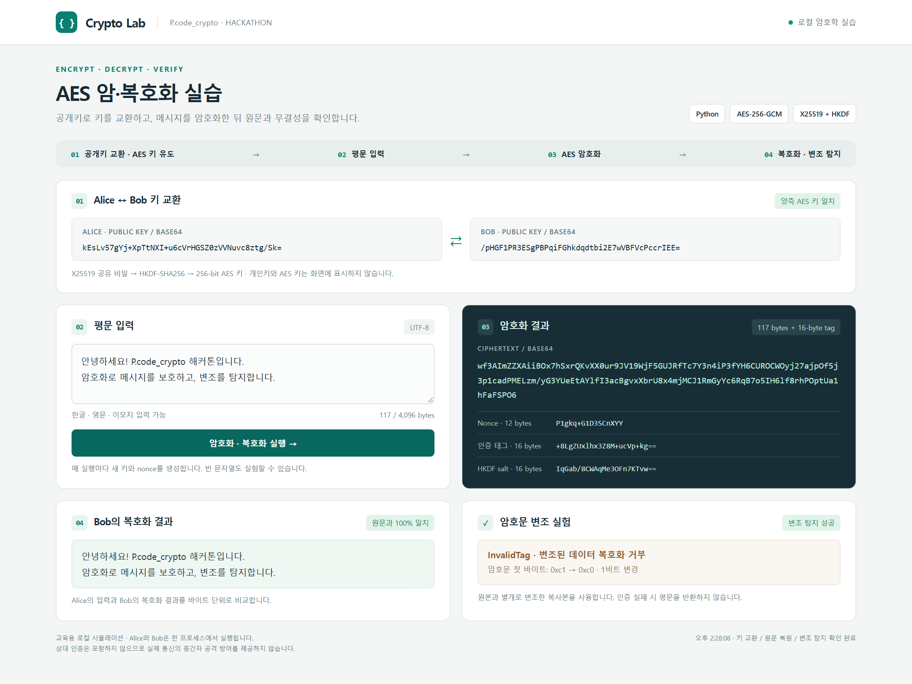

# Crypto Lab

**Python 기반 AES 암·복호화, 키 교환 및 변조 탐지 실습**

P.code_crypto 해커톤 활동을 위한 교육용 프로젝트입니다. 브라우저에서 평문을 입력하면 Python 서버가 X25519 키 교환, AES-256-GCM 암호화와 복호화를 수행하고 결과를 보여 줍니다. 같은 암호문의 1비트를 바꿔 인증 실패도 확인할 수 있습니다.

암호 연산은 [`cryptography`](https://cryptography.io/) 라이브러리를 사용합니다. 프로젝트의 구현 범위는 키 교환과 키 유도, 암·복호화 흐름, 변조 실험, 웹 화면 및 검증 코드입니다.

## 실행 화면



캡처에는 입력 평문, 양측 공개키, 암호문, nonce, 인증 태그, 복호화 결과와 변조 탐지 결과가 표시되어 있습니다. 매 실행마다 새 키와 난수를 생성하므로 암호문과 공개키는 달라집니다.

## 주요 기능

- **키 교환:** Alice와 Bob이 X25519로 공유 비밀을 계산하고 HKDF-SHA256으로 같은 AES 키를 유도합니다.
- **암호화:** UTF-8 문자열을 AES-256-GCM으로 암호화하고 암호문과 인증 태그를 구분해 표시합니다.
- **복호화:** Bob의 키로 인증 태그를 검증한 후 평문을 복원하고 입력과 비교합니다.
- **변조 탐지:** 암호문 복사본의 1비트를 바꿔 `InvalidTag` 발생 여부를 확인합니다. 빈 입력에서는 인증 태그를 변조합니다.
- **입력 처리:** 한글, 영문, 이모지, 줄바꿈과 빈 문자열을 지원합니다. 최대 입력은 UTF-8 기준 4,096바이트입니다.

## 빠른 시작

CPython 3.10–3.13과 웹 브라우저가 필요합니다. 아래 명령은 **이 README와 `app.py`가 있는 폴더**에서 실행합니다. 가상환경의 Python을 직접 호출하므로 별도 활성화 작업은 필요하지 않습니다.

### Windows · PowerShell

```powershell
python -m venv .venv
.\.venv\Scripts\python.exe -m pip install -r requirements.txt
.\.venv\Scripts\python.exe app.py
```

`python` 명령이 없다면 Python 설치 후 터미널을 다시 열거나, 첫 줄을 `py -3.10 -m venv .venv`로 실행합니다.

### macOS / Linux

```bash
python3 -m venv .venv
.venv/bin/python -m pip install -r requirements.txt
.venv/bin/python app.py
```

터미널에 주소가 출력되면 **[http://127.0.0.1:8765](http://127.0.0.1:8765)** 에 접속합니다. 평문을 입력하고 **암호화 · 복호화 실행** 버튼을 누르면 전체 실습이 실행됩니다. 서버 종료는 터미널에서 `Ctrl+C`를 누릅니다.

외부 서비스 계정, API 키, `.env` 파일, Node.js 또는 프런트엔드 빌드 작업은 필요하지 않습니다. `index.html`은 Python 서버를 통해 엽니다.

### 포트 변경

기본 포트가 사용 중이면 다른 포트로 실행합니다.

```powershell
# Windows
.\.venv\Scripts\python.exe app.py --port 9000
```

```bash
# macOS / Linux
.venv/bin/python app.py --port 9000
```

이때 접속 주소는 `http://127.0.0.1:9000`입니다.

## 동작 과정

```text
Alice의 개인키 + Bob의 공개키 ── X25519 ──┐
                                         ├─ 같은 공유 비밀
Bob의 개인키 + Alice의 공개키 ── X25519 ──┘
                                                  │
                                    HKDF-SHA256 + 같은 salt
                                                  │
                                        양측 256-bit AES 키
                                                  │
입력 평문 ── AES-GCM 암호화 ── 암호문 + 태그 ── 인증·복호화 ── 원문 비교
                                      │
                                복사본 1비트 변경
                                      │
                              인증 실패: InvalidTag
```

| 항목 | 설정 |
| --- | --- |
| 키 교환 | X25519 · 실행마다 새로운 개인키 생성 |
| 키 유도 | HKDF-SHA256 · 출력 32바이트 · 공개 salt 16바이트 |
| 암호화 | AES-256-GCM |
| Nonce / 인증 태그 | 12바이트 / 16바이트 |
| 난수 | OS 난수 기반 키 생성 및 `secrets.token_bytes` |
| 평문 인코딩 / 바이너리 표시 | UTF-8 / Base64 |
| 추가 인증 데이터(AAD) | `P.code_crypto \| AES-GCM demo \| v1` |
| 서버 주소 | `127.0.0.1` · 기본 포트 `8765` |

## 테스트

개발용 의존성에는 독립 복호화 검증에 사용하는 `pycryptodome`이 포함됩니다.

```powershell
# Windows
.\.venv\Scripts\python.exe -m pip install -r requirements-dev.txt
.\.venv\Scripts\python.exe -B -m unittest discover -s . -p "test_*.py" -v
```

```bash
# macOS / Linux
.venv/bin/python -m pip install -r requirements-dev.txt
.venv/bin/python -B -m unittest discover -s . -p "test_*.py" -v
```

검증 항목은 다음과 같습니다.

- NIST AES-256-GCM, RFC 7748 X25519, RFC 5869 HKDF 공개 테스트 벡터
- 한글·이모지·빈 문자열·최대 길이 입력의 복원 및 변조 탐지
- 잘못된 키·nonce·AAD·태그, 잘린 암호문에 대한 인증 실패
- 잘못된 입력 형식·크기, 무효한 공개키 및 다른 Origin의 API 요청 거부
- PyCryptodome을 이용한 독립 복호화 교차 검증

**로컬 검증 기록:** 2026-10-16, Windows / Python 3.10.11에서 총 12개 테스트 통과. 브라우저에서 정상 실행, 입력 오류 후 재실행, HTML 문자열 표시, 모바일 폭의 화면도 확인했습니다. 실행 의존성만 설치하면 독립 구현 검증 1개는 건너뛰며, `requirements-dev.txt`를 설치하면 12개 모두 실행됩니다.

[GitHub Actions 설정](.github/workflows/tests.yml)은 push, pull request, 수동 실행 시 Windows·Ubuntu와 Python 3.10·3.13 조합에서 테스트합니다. 원격 CI의 실제 결과는 업로드 후 저장소의 **Actions** 탭에서 확인할 수 있습니다.

## 프로젝트 구조

```text
.
├── .github/workflows/tests.yml  # GitHub Actions 자동 테스트
├── .editorconfig               # UTF-8, 들여쓰기 및 개행 규칙
├── .gitattributes              # Git 텍스트/이미지 처리
├── .gitignore                  # 가상환경, 캐시, 로컬 파일 제외
├── .python-version             # 기본 Python 버전 계열
├── app.py                      # 암호 실습 로직 및 로컬 HTTP 서버
├── index.html                  # 웹 화면과 API 호출
├── test_app.py                 # 표준 벡터, 입력 및 API 검증
├── requirements.txt            # 실행 의존성
├── requirements-dev.txt        # 테스트 의존성
├── screenshots/01_crypto_demo.png
├── LICENSE
└── README.md
```

## 실습 범위

Alice와 Bob은 **하나의 Python 프로세스에서 모사**됩니다. 상대 공개키의 진위를 신뢰하는 환경에서 암호문 변조를 시험하며, 상대 인증이나 실제 네트워크 키 교환은 구현하지 않습니다. 중간자 공격 방어, 키 보관, 운영용 서버 및 부채널 방어는 범위에 포함되지 않습니다.

앱은 개인키와 AES 키를 응답·파일·로그에 저장하지 않습니다. 입력 평문과 복호화 결과는 실습을 위해 브라우저에 표시됩니다. 테스트의 고정 키와 nonce는 공개 벡터 재현에만 사용합니다.

테스트 통과는 해당 입력에서의 동작 확인 결과입니다. 전체 시스템의 보안성을 증명하지 않으며, 이 프로젝트는 교육용으로 사용합니다.

## 참고 자료

문서 확인일: **2026-10-16**.

- Python Cryptographic Authority, [Authenticated encryption](https://cryptography.io/en/50.0.2/hazmat/primitives/aead/), 문서 버전 50.0.2. 구현에는 검증한 `cryptography` 45.0.7을 사용합니다.
- Python Cryptographic Authority, [X25519 key exchange](https://cryptography.io/en/50.0.2/hazmat/primitives/asymmetric/x25519/), 문서 버전 50.0.2.
- NIST, [GCM Mode for Authentication and Confidentiality: Examples](https://csrc.nist.gov/CSRC/media/Projects/Cryptographic-Standards-and-Guidelines/documents/examples/AES_GCM.pdf), GCM-AES256 Example #1–2, pp. 21–23.
- A. Langley, M. Hamburg, S. Turner, [Elliptic Curves for Security](https://www.rfc-editor.org/rfc/rfc7748.txt), RFC 7748 §6.1, 2016.
- H. Krawczyk, P. Eronen, [HMAC-based Extract-and-Expand Key Derivation Function (HKDF)](https://www.rfc-editor.org/rfc/rfc5869.txt), RFC 5869 A.1, 2010.

## 라이선스

[MIT License](LICENSE). 사용한 외부 라이브러리에는 각 프로젝트의 라이선스가 적용됩니다.
